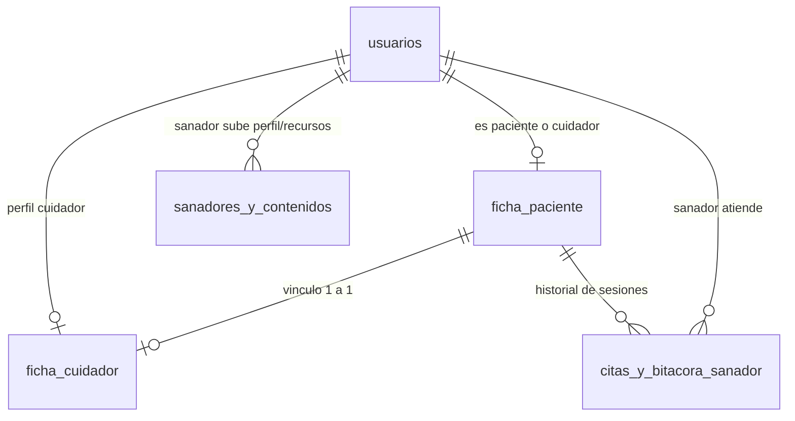

# Arquitectura de Módulos y Base de Datos — Love Heals Effect (V1.0)

Este documento resume y justifica cómo está organizado el proyecto **Love Heals Effect** (enfocado en el acompañamiento integral de personas afectadas por el **cáncer de mama**, sus cuidadores y sus sanadores) tanto a nivel de **Módulos en Next.js** como en su **Base de Datos en PostgreSQL**.

---

## 1. Principio Central del Diseño: Todo Gira Alrededor de la Paciente

En el proceso del cáncer de mama, la paciente suele recibir múltiples documentos del oncólogo, indicaciones de medicamentos y terapias complementarias (coaching, meditación, cuencos sonoros, reiki, nutrición). Cuando está agotada tras una quimioterapia o cirugía, le resulta muy difícil recordar y repetir toda su historia clínica en cada cita.

Por eso, la plataforma se construye sobre una regla fundamental:
* Existen **4 roles distintos** (**Paciente**, **Cuidador**, **Sanador** y **Administrador**), cada uno con su propio inicio de sesión y contenido adaptado.
* Sin embargo, **toda la información clínica, logística y de seguimiento converge en una sola Ficha Central de la Paciente**, garantizando trazabilidad continua sin que ella tenga que empezar desde cero en cada sesión.

---

## 2. Los 6 Módulos del Proyecto y su Justificación

```text
src/app/
├── page.tsx          -> Módulo 1: Página Web Pública de Inicio (EN / ES + QR)
├── auth/             -> Módulo 2: Login y Registro Vinculado (Paciente <-> Cuidador)
├── paciente/         -> Módulo 3: Panel de la Paciente (Eje Central)
├── cuidador/         -> Módulo 4: Panel del Cuidador (Contenido propio + Vista compartida)
├── sanador/          -> Módulo 5: Panel del Sanador (Fase 1: Omar & Kelsey + Bitácora + IA)
└── admin/            -> Módulo 6: Panel Administrador (CMS, Control de Roles y Entrenamiento IA)
```

### Módulo 1: Página Web Pública de Inicio (`/`) — *¡Ya estructurado!*
* **Qué hace:** Presenta quiénes somos, qué hacemos y qué brindamos para personas con cáncer de mama y sus familias, con selector de idioma **Inglés / Español (`EN | ES`)**.
* **Por qué es necesario:** Es el punto de llegada cuando las personas escanean el **código QR (*"Login Here"*)** en eventos, conferencias o centros de cáncer en Hawái. Ofrece los enganches gratuitos iniciales (grupos de soporte por Zoom o presenciales con Omar y Kelsey y acceso al registro).

### Módulo 2: Login y Registro Vinculado (`/auth`)
* **Qué hace:** Permite iniciar sesión con credenciales propias y redirige a cada usuario a su panel según su rol (`paciente`, `cuidador`, `sanador` o `admin`).
* **Por qué tiene doble flujo en el registro ("Célula Paciente – Cuidador"):**
  1. **Si la Paciente se registra primero:** Crea su cuenta y su ficha, y tiene la opción de agregar/invitar a su cuidador (o dejar ese espacio pendiente para después).
  2. **Si el Cuidador se registra primero:** Pensando en que la paciente puede estar en cama sin energía tras un tratamiento, el cuidador crea su cuenta y puede **registrar a su paciente en 3 pasos simples**, dejando ambas cuentas vinculadas 1 a 1 desde el inicio.

### Módulo 3: Panel de la Paciente (`/paciente`)
* **Qué hace:** Ofrece contenido adaptado a su etapa (*Diagnóstico, Tratamiento Activo, Cirugía y Recuperación, Remisión*), su lista de medicamentos con horarios, calendario de citas médicas, repositorio para subir documentos/notas del oncólogo, acceso a contenidos de sanadores (música, podcasts, libros) y reservas de sesiones (*Booking*).
* **Por qué es necesario:** Centraliza en un solo lugar digital toda la información que hoy suele perderse en papeles impresos de la clínica.

### Módulo 4: Panel del Cuidador (`/cuidador`)
* **Qué hace:** Muestra contenido pensado exclusivamente para quien cuida (guías prácticas para síntomas nocturnos, recetas, manejo del agotamiento y grupos de soporte con Omar), junto con una **vista sincronizada** de los medicamentos, citas y documentos de su paciente.
* **Por qué tiene un login distinto al de la paciente:** Aunque están vinculados 1 a 1, el cuidador necesita herramientas y contención emocional diferentes a las de la paciente.

### Módulo 5: Panel del Sanador (`/sanador`) — *Fase 1: Omar y Kelsey*
* **Qué hace:**
  1. **Perfil y Contenidos:** Biografía corta (*short bio*) y carga de recursos gratuitos o comunitarios (**música, podcasts, libros/PDFs, videos y meditaciones**).
  2. **Booking (Online y En Persona):** Administración de disponibilidad para que pacientes y cuidadores reserven sesiones.
  3. **Trazabilidad e IA antes y después de la cita:** Antes de atender, el sanador lee el **Resumen Ejecutivo generado por IA** con los medicamentos, etapa y sesiones previas de la paciente. Al terminar, llena una **Bitácora Post-Sesión** (notas, patrones detectados, recomendaciones y carga de documento Word/PDF o audio/transcripción).
* **Por qué es necesario:** En esta primera versión, **Omar y Kelsey** validan el flujo como los primeros sanadores activos, dejando la estructura lista para sumar más especialistas (quiroprácticos, acupunturistas, reiki, *sound bowls*, músicos, etc.) sin perder el historial de la paciente.

### Módulo 6: Panel Administrador (`/admin`)
* **Qué hace:** Permite gestionar los textos informativos de la web pública (`EN / ES`), supervisar los registros de Pacientes, Cuidadores y Sanadores, y revisar/afinar los resúmenes generados por la IA.
* **Por qué es necesario:** Permite entrenar y validar internamente la calidad de la IA con casos reales antes de abrir el asistente conversacional directo al público en la **Versión 2.0**.

---

## 3. Estructura Simplificada de la Base de Datos (5 Tablas en PostgreSQL)

Para mantener la Primera Versión ágil, clara y fácil de ajustar si se agregan campos nuevos, toda la base de datos (ver [database/schema.sql](file:///c:/Users/epesc/Documents/Love%20Heals%20Effect/database/schema.sql)) se organiza en **5 tablas esenciales**:



### 1. `usuarios` (El Login de todos)
* **Qué guarda:** `id`, `nombre`, `correo`, `password_hash`, `telefono`, `rol` (`paciente`, `cuidador`, `sanador`, `admin`), `idioma_preferido` (`es` / `en`) y `estado`.
* **Justificación:** Unifica la autenticación en una sola tabla segura y permite redirigir a cada persona a su módulo correspondiente según su rol.

### 2. `ficha_paciente` (El corazón donde todo se conecta)
* **Qué guarda:** `paciente_usuario_id`, `cuidador_usuario_id` (el vínculo 1 a 1), `etapa_actual`, `antecedentes_medicos`, `medicamentos_y_horarios`, `citas_medicas`, `documentos_oncologo` y `resumen_ia`.
* **Justificación:** Es la fuente única de verdad sobre la paciente. Al tener aquí tanto `paciente_usuario_id` como `cuidador_usuario_id`, ambos logins ven y actualizan el mismo calendario y ficha sin duplicar datos, y la IA tiene en un solo lugar el resumen actualizado para los sanadores.

### 3. `ficha_cuidador` (Lo propio del Cuidador)
* **Qué guarda:** `cuidador_usuario_id`, `ficha_paciente_id`, `parentesco`, `rol_cuidado`, `horarios_disponibles`, `areas_de_interes` y `estado_vinculo`.
* **Justificación:** Separa la información personal y necesidades de apoyo del cuidador de los datos clínicos de la paciente.

### 4. `sanadores_y_contenidos` (Perfiles de Sanadores y sus Recursos)
* **Qué guarda:** Datos del sanador (`especialidad`, `short_bio_es/en`, `modalidades`, `disponibilidad_horaria`, `es_fundador`) y los contenidos que sube (`tipo_contenido`: música, podcast, libro PDF, video, meditación; `media_url`, `publico_objetivo`).
* **Justificación:** En la Fase 1 permite que Omar y Kelsey publiquen sus perfiles y recursos multimedia (enlaces embebidos de YouTube/Spotify/PDF sin saturar la base de datos) y deja lista la tabla para el directorio futuro de sanadores.

### 5. `citas_y_bitacora_sanador` (Booking + Trazabilidad Post-Sesión)
* **Qué guarda:** `ficha_paciente_id`, `sanador_usuario_id`, `modalidad` (`online` o `presencial`), `fecha_sesion`, `estado_cita`, y los campos de bitácora (`estado_observado_paciente`, `patrones_detectados`, `recomendaciones_dadas`, `archivo_adjunto_url`, `transcripcion_o_notas`).
* **Justificación:** Conecta cada reserva con su resultado clínico-holístico. Cada nueva bitácora guardada aquí alimenta a la herramienta de IA para actualizar el `resumen_ia` en `ficha_paciente`.
